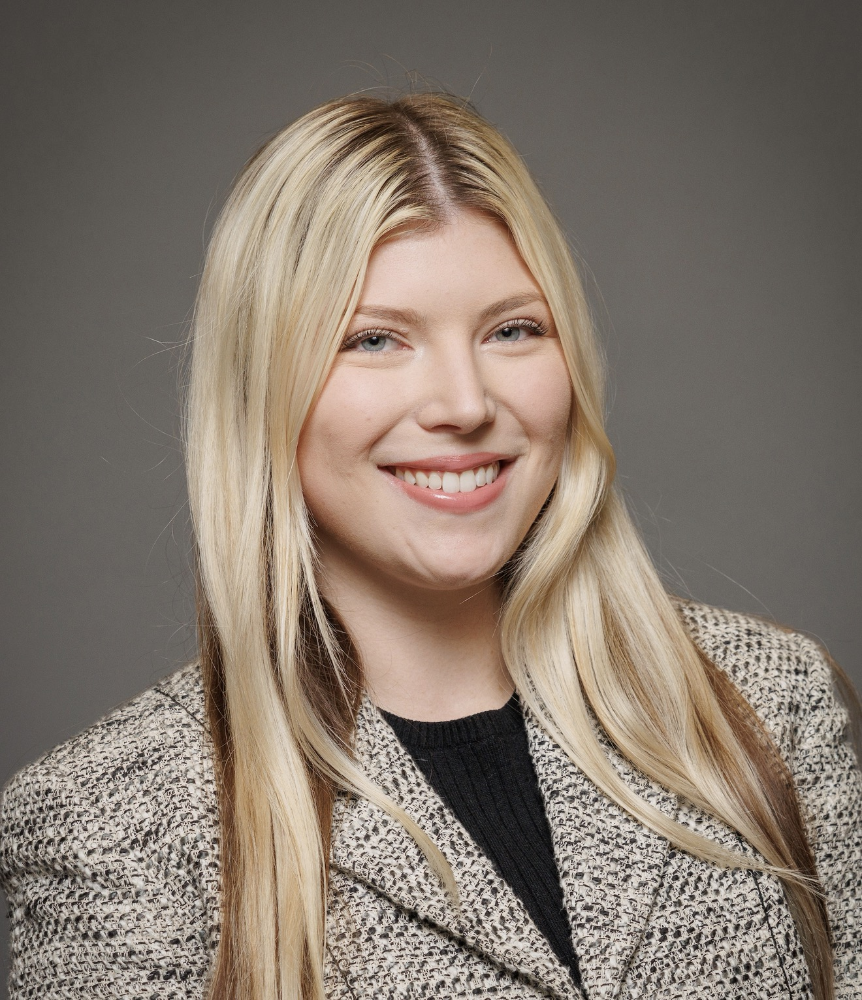
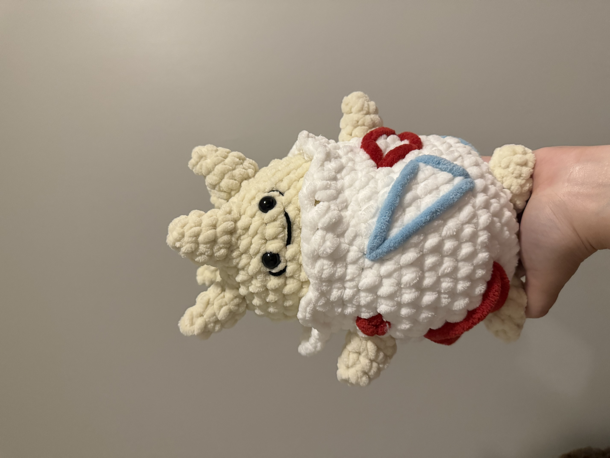
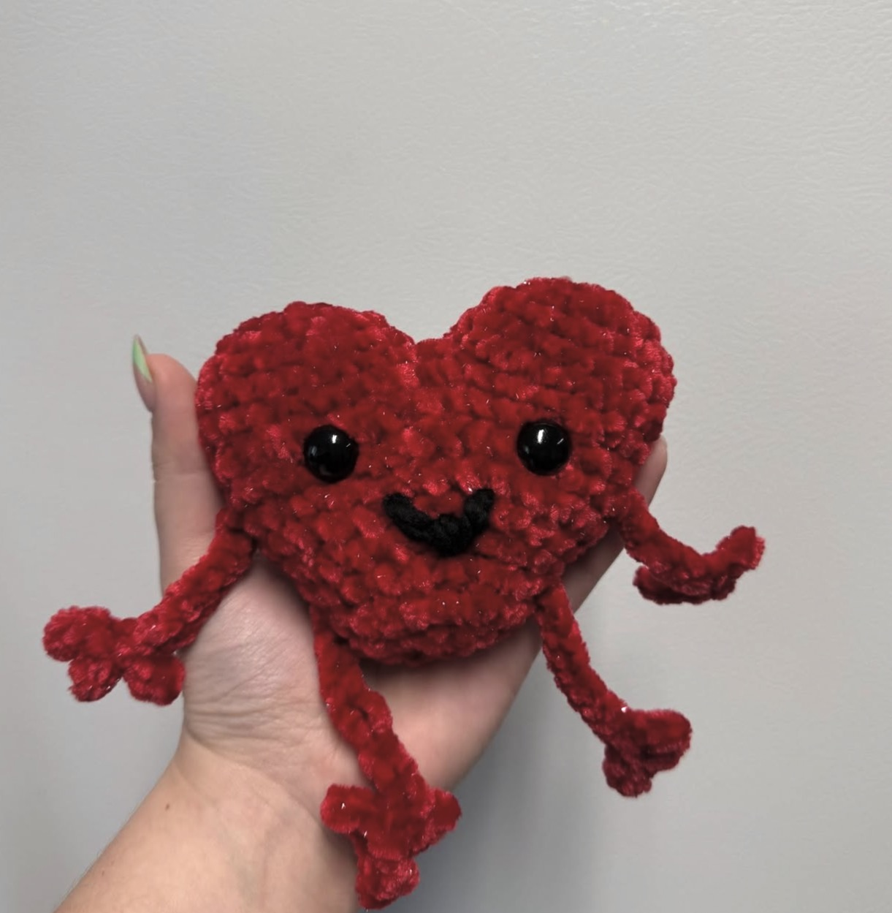

---
title: ""
page-layout: full
---

```{=html}
<div class="about-page">

  <div class="about-banner">
    <div class="cloud cloud-one"></div>
    <div class="cloud cloud-two"></div>

    <div class="hero-content">
      <div class="welcome-text">A LITTLE MORE ABOUT ME</div>
      <h1>Hello, nice to meet you! ♡</h1>
      <p class="tagline">
        Mathematics, data science &amp; lifelong curiosity.
      </p>
    </div>

    <div class="cloud-border"></div>
  </div>

  <div class="story-section">

    

    <div class="story-text">
      <h2>My Story</h2>

      <p>
        I'm Maxine, a graduate student pursuing my M.S.
        in Data Science at Emory University's Laney
        Graduate School. I previously earned my B.S.
        in Applied Mathematics and Statistics from
        Emory University, graduating cum laude.
      </p>

      <p>
        My interests lie at the intersection of mathematics,
        statistics, technology, and real-world problem-solving.
        I enjoy transforming complex data into meaningful
        insights and developing solutions that make information
        more accessible, understandable, and actionable.
      </p>

      <p>
        As an actuarial candidate with Exams P and FM
        passed, I am particularly interested in quantitative
        modeling, risk analysis, and the application of
        data science to business decisions.
      </p>
    </div>

  </div>

  <h2 class="section-heading">My Academic Journey</h2>

  <div class="academic-timeline">

    <div class="timeline-item">
      <div class="timeline-date">2022 – 2025</div>
      <h3>B.S. in Applied Mathematics &amp; Statistics</h3>
      <p>Emory University</p>
      <p>3.95 GPA · Cum Laude</p>
    </div>

    <div class="timeline-item">
      <div class="timeline-date">March 2026</div>
      <h3>Actuarial Exam P</h3>
      <p>Probability — Passed</p>
    </div>

    <div class="timeline-item">
      <div class="timeline-date">August 2026</div>
      <h3>Actuarial Exam FM</h3>
      <p>Financial Mathematics — Passed</p>
    </div>

    <div class="timeline-item">
      <div class="timeline-date">2026 – 2027</div>
      <h3>M.S. in Data Science</h3>
      <p>Emory University · Laney Graduate School</p>
      <p>Expected graduation: August 2027</p>
    </div>

  </div>

  <h2 class="section-heading">What I Do</h2>

  <div class="info-grid">

    <div class="info-card">
      <div class="card-icon">💻</div>
      <h3>Data Science &amp; Research</h3>
      <p>
        As a Graduate Data Science Fellow at Emory
        University's Center for AI Learning, I support
        Emory Healthcare's Academic Partnerships team
        through data analysis, visualization, and
        workflow automation projects.
      </p>
    </div>

    <div class="info-card">
      <div class="card-icon">📊</div>
      <h3>Actuarial Science</h3>
      <p>
        I am pursuing a career in actuarial science,
        combining my mathematical background with
        statistical modeling, programming, and an
        interest in understanding risk and uncertainty.
      </p>
    </div>

    <div class="info-card">
      <div class="card-icon">🎓</div>
      <h3>Teaching</h3>
      <p>
        As a Regression Analysis Teaching Assistant
        at Emory University, I help students develop
        their understanding of statistical methods,
        regression modeling, and programming in R.
      </p>
    </div>

    <div class="info-card">
      <div class="card-icon">📚</div>
      <h3>Math2TheMax Tutoring</h3>
      <p>
        Through my independent mathematics tutoring
        business, I provide personalized instruction
        to help students build mathematical confidence,
        strengthen problem-solving skills, and achieve
        their academic goals.
      </p>
    </div>

  </div>

  <h2 class="section-heading">My Technical Toolkit</h2>

  <div class="skill-tags">
    <span>R</span>
    <span>Python</span>
    <span>SQL</span>
    <span>Java</span>
    <span>Excel</span>
    <span>GitHub</span>
    <span>Quarto</span>
    <span>SharePoint</span>
    <span>Power Automate</span>
    <span>Statistical Modeling</span>
    <span>Machine Learning</span>
    <span>Data Visualization</span>
    <span>Web Scraping</span>
    <span>Natural Language Processing</span>
  </div>

  
<div class="personal-section">

  <div class="card-icon">🧶</div>

  <h2>Beyond the Numbers ♡</h2>

  <p>
    Outside of academics and work, I love crocheting
    and bringing creative ideas to life, one stitch
    at a time. It's a wonderful way to express my
    creativity and explore something beyond the
    world of mathematics and data science.
  </p>

  <div class="crochet-gallery">

    

    

    

  </div>

  <a class="social-button crochet-button"
     href="https://www.instagram.com/craftedbymaxine/"
     target="_blank" rel="noopener noreferrer">
    <i class="bi bi-instagram"></i>
    @craftedbymaxine
  </a>

  <p class="crochet-caption">
    A little creativity, one stitch at a time. ♡
  </p>

</div>


  <p class="closing-message">
    Always learning, always curious. ♡
  </p>

</div>
```
