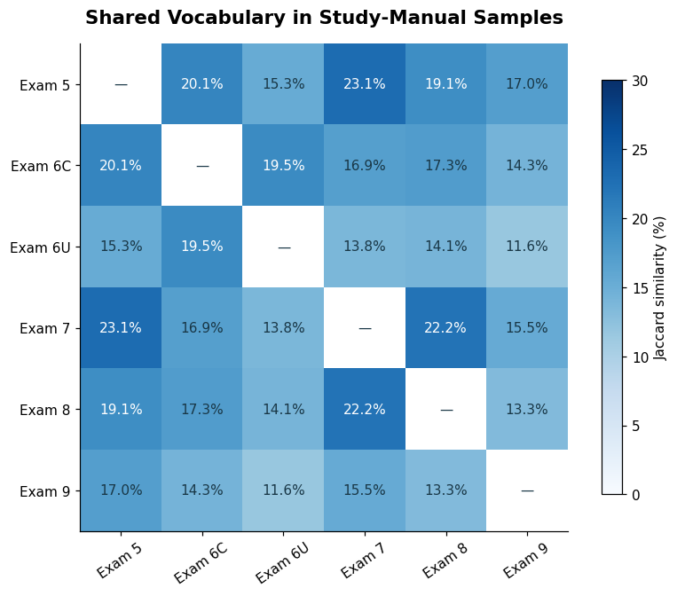
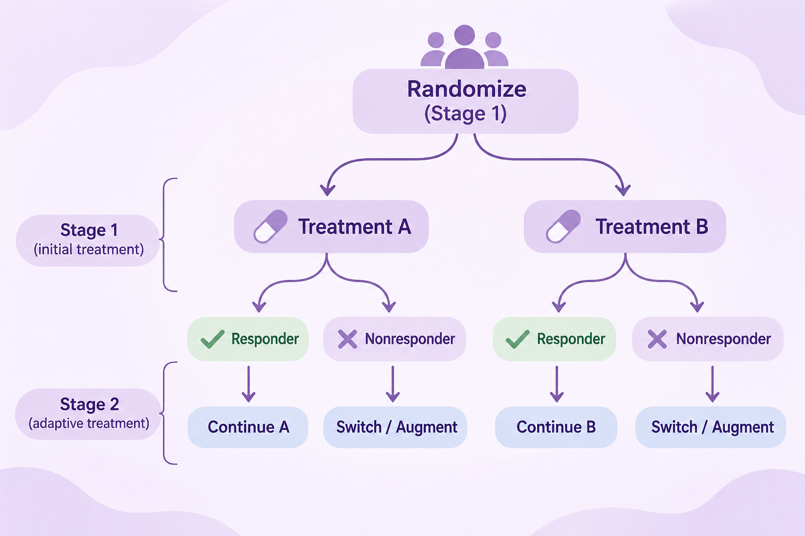

```{=html}
<div class="portfolio-section-heading">
  <h2>Featured Projects</h2>
  <p>A collection of my work in data science, actuarial science, and statistical research.</p>
</div>

<div class="portfolio-project-grid">

  <div class="portfolio-project-card">
    

    <div class="portfolio-project-content">

      <h2>Actuarial Exam Preparation Market Intelligence</h2>

      <p class="portfolio-project-subtitle">BattleActs</p>

      <p>An end-to-end data science project exploring actuarial exam preparation materials through automated web scraping, product data collection, text mining, and comparative analysis.</p>

      <div class="portfolio-tags">
        <span>Python</span>
        <span>Selenium</span>
        <span>Web Scraping</span>
        <span>NLP</span>
        <span>Data Visualization</span>
        <span>Competitive Intelligence</span>
      </div>

      <a class="portfolio-project-button"
         href="https://github.com/maxinehb/battleacts-market-intelligence"
         target="_blank" rel="noopener noreferrer">
         View on GitHub ↗
      </a>
    </div>
  </div>

  <div class="portfolio-project-card">
    

    <div class="portfolio-project-content">

      <h2>SMART Experiments: What Comes Next?</h2>

      <p class="portfolio-project-subtitle">Interactive Statistical Explainer</p>

      <p>An interactive statistical explainer exploring Sequential Multiple Assignment Randomized Trials (SMARTs) as an extension of traditional A/B testing. Combines animated visualizations, a real clinical trial example, and Monte Carlo simulations to demonstrate adaptive treatment strategies, statistical estimation, and inference.</p>

      <div class="portfolio-tags">
        <span>R</span>
        <span>Quarto</span>
        <span>Experimental Design</span>
        <span>Monte Carlo Simulation</span>
        <span>Statistical Inference</span>
        <span>Data Visualization</span>
        <span>JavaScript</span>
      </div>

      <div class="portfolio-project-links">
        <a class="portfolio-project-button"
           href="https://maxinehb.github.io/smart-experiments-explainer/"
           target="_blank" rel="noopener noreferrer">
           View Interactive Explainer ↗
        </a>

        <a class="portfolio-project-button secondary-button"
           href="https://github.com/maxinehb/smart-experiments-explainer"
           target="_blank" rel="noopener noreferrer">
           View on GitHub ↗
        </a>
      </div>
    </div>
  </div>

  <div class="portfolio-project-card">
    <div class="portfolio-project-placeholder">☁️</div>

    <div class="portfolio-project-content">
      <span class="portfolio-status in-progress">In Progress</span>

      <h2>Actuarial Text Mining</h2>

      <p>Exploring thematic patterns and relationships within actuarial text using natural language processing, unsupervised machine learning, and clustering techniques.</p>

      <div class="portfolio-tags">
        <span>Python</span>
        <span>NLP</span>
        <span>Machine Learning</span>
        <span>Clustering</span>
      </div>

      <p class="portfolio-coming-soon">Coming soon ♡</p>
    </div>
  </div>

</div>

<div class="portfolio-closing">
  <p>More projects and discoveries to come! ♡</p>
</div>
```